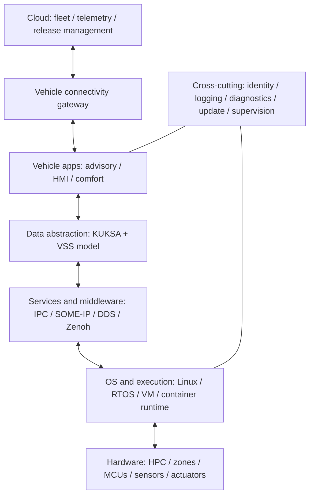

# 01 — Thiết kế kiến trúc SDV trước khi chọn tool

## 1. Ba góc nhìn phải có

**Physical architecture** mô tả phần cứng và dây nối: MCU, HPC, CAN, Ethernet, cảm biến, nguồn điện. **Logical architecture** mô tả trách nhiệm phần mềm: provider, signal broker, application, diagnostic service, update manager. **Deployment architecture** gán phần mềm lên node/process/container/VM cụ thể.

Một logical service có thể chạy ở nhiều vị trí. Chuyển từ laptop sang board chỉ giữ nguyên chức năng nếu các giả định về CPU, clock, network, dependency và OS vẫn đúng.

## 2. E/E architecture phát triển ra sao?

```text
Distributed: sensor → ECU chức năng → bus → ECU chức năng khác
Domain:     ECU nhỏ → domain controller (body/powertrain/ADAS...) → backbone
Zonal:      sensor/ECU gần nhau → zone controller → Ethernet → central compute
```

Domain gom theo chức năng. Zone gom theo vị trí vật lý để thu gọn kết nối và đưa một phần xử lý về compute mạnh hơn. Xe thực tế có thể kết hợp nhiều kiểu. Không phải mọi vòng điều khiển đều chuyển lên Linux HPC: một MCU cục bộ vẫn có thể giữ vòng điều khiển nhanh và trạng thái dự phòng.

## 3. Stack tham chiếu cho giáo trình



Đây là **kiến trúc sư phạm do bộ tài liệu lựa chọn**, không phải một “Eclipse reference stack” bắt buộc. Một SOME/IP service có thể được app truy cập trực tiếp; không phải mọi dữ liệu đều đi qua KUKSA. S-CORE là nhánh core platform riêng cần integration design, không được mặc định nằm trong đường chạy demo.

## 4. Giải thích từng lớp bằng project mẫu

| Lớp | Có trong demo | Khi lên hệ thống thực |
| --- | --- | --- |
| Hardware | Laptop, dữ liệu giả | Board Linux + ECU/sensor |
| OS | Windows cho bài offline; Linux cho container/CAN | BSP, kernel, boot chain, watchdog |
| Vehicle I/O | Simulator, sau đó `vcan0` | CAN transceiver/driver, Ethernet, DBC hợp lệ |
| Provider | Chuyển nguồn thành signal có timestamp | Decode, quality, timeout, mapping version |
| Data abstraction | KUKSA, schema 4 signal | ACL, schema evolution, ownership |
| App | Rule và hysteresis | Requirements, calibration, fail behavior |
| Presentation | JSON logs và subscriber | HMI/API, output freshness |
| Lifecycle | Compose, manifest Ankaios nâng cao | Boot, restart, rollout, rollback |
| Cloud | Chưa implement | Connector, identity, offline queue |

## 5. Data plane và control plane

Data plane là đường chạy dữ liệu chức năng: provider → broker → advisor. Control plane quản lý workload: ai chạy advisor, image nào, cấu hình nào, restart ra sao. Ankaios thuộc câu chuyện control plane; nó không decode CAN hay tự chuyển signal giữa app.

OTA còn có release metadata, chữ ký, điều kiện cho phép cập nhật, tương thích phiên bản và phục hồi. Khởi động container mới chỉ là một bước của chuỗi này.

## 6. Một luồng dữ liệu cụ thể

```text
t0 sensor/ECU tạo giá trị
t1 gateway nhận frame
t2 provider decode và publish
t3 broker lưu/phát thông báo
t4 advisor đọc và tính
t5 HMI/observer nhận kết quả
```

Tuổi dữ liệu tại app là `t4 - t0` nếu timestamp thực sự là thời điểm đo. Trong SocketCAN lab, timestamp được gán tại lúc provider nhận frame: số đo tuổi chỉ bao phủ từ gateway trở đi. Phải nói rõ điều đó trong thiết kế.

Ví dụ ngân sách tự đặt cho prototype: provider 1 Hz, RPC deadline 2 giây, input quá 3 giây thành UNKNOWN. Những con số này phù hợp bài học giám sát chậm; không chứng minh deadline cho braking/steering hay control loop.

## 7. Các quyết định kiến trúc của demo

- **ADR-001:** chọn advisory để học luồng dữ liệu; output là derived sensor, không phải actuator.
- **ADR-002:** dùng VAL v2 và proto đúng commit broker để tránh ghép SDK v1 với actuation v2.
- **ADR-003:** tách pure policy khỏi transport để test lỗi dữ liệu không cần khởi động cả stack.
- **ADR-004:** polling 1 Hz cho advisor dễ quan sát; subscriber riêng để học streaming. Không tuyên bố các lần publish riêng lẻ là atomic transaction.
- **ADR-005:** chỉ bind cổng broker ra loopback host trong Compose; TLS/ACL là mốc nâng cấp có test riêng.

## Bài tập và đầu ra

Vẽ ba sơ đồ cho cùng chức năng: physical, logical, deployment. Trên mỗi mũi tên ghi protocol, data owner và ý nghĩa timestamp. Ghi một yêu cầu CPU/RAM, một deadline và một behavior khi mất provider.

Hoàn thành khi bạn chỉ ra được trên sơ đồ: Eclipse KUKSA, Ankaios, Leda và S-CORE giải quyết những lớp khác nhau. Nguồn để so sánh vai trò: [KUKSA system architecture](https://github.com/eclipse-kuksa/kuksa-databroker/blob/0.7.1/doc/system-architecture.md), [Ankaios architecture](https://github.com/eclipse-ankaios/ankaios/blob/v1.1.0/doc/docs/architecture.md).
